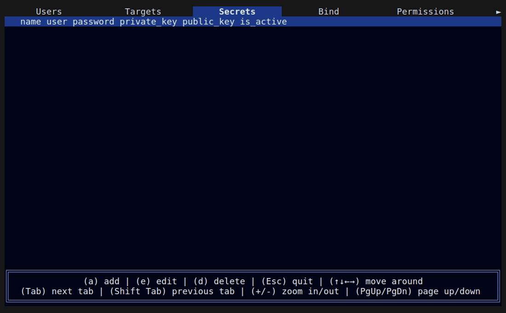
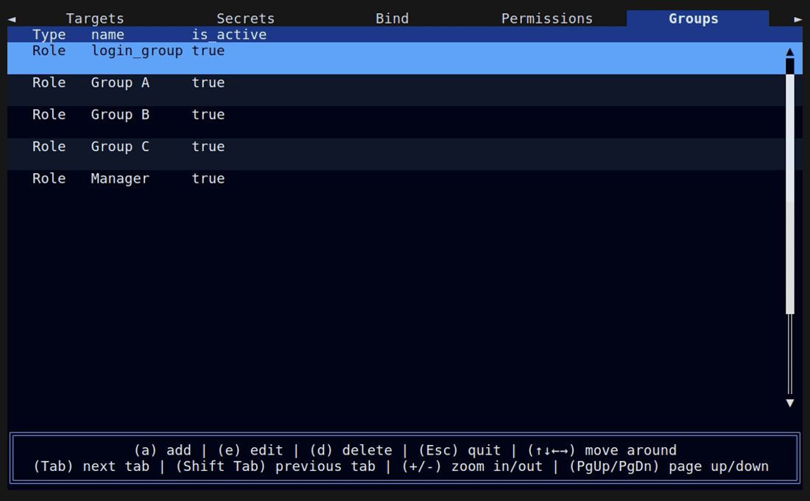
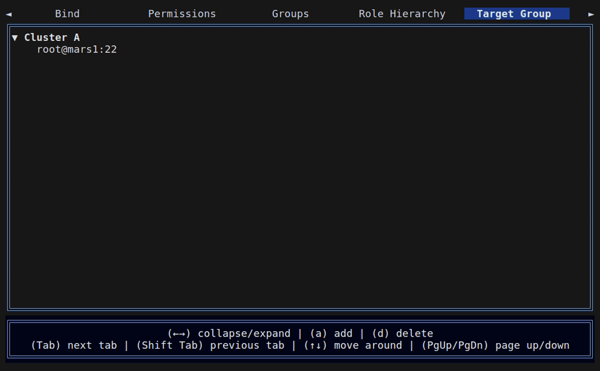
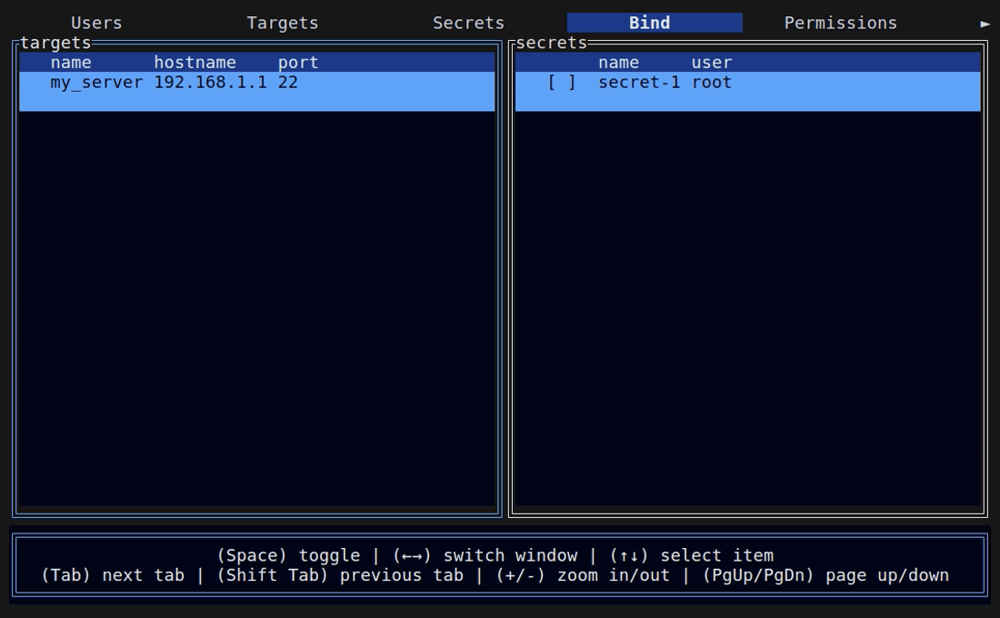
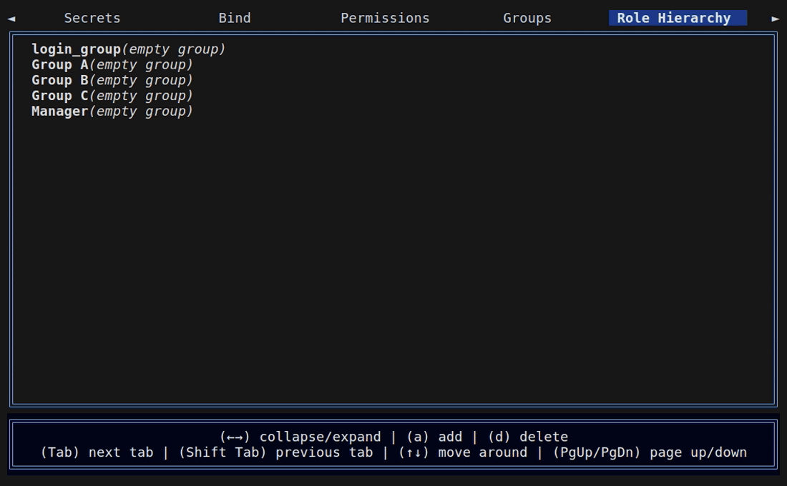

# Rustion

**Rustion** is a lightweight, high-performance SSH bastion/jump host server with a TUI management interface, written in Rust 🦀.

## 🤔 What is a Bastion Server?

A bastion server (also known as a jump host) is a secure gateway that acts as the single entry point for accessing internal servers. Instead of connecting directly to target machines, users first connect to the bastion, which then forwards their connection to the intended destination. This architecture:

- 🔒 Centralizes access control and auditing
- 🎯 Reduces the attack surface of your infrastructure
- 📋 Provides a single point for monitoring and logging all SSH activity
- 🛡️ Enables fine-grained authorization policies

Rustion implements this concept with modern Rust technologies, offering security, performance, and flexibility.

⚠️ **Warning:** Rustion is under active development and should **not** be used in production environments without thorough testing. The API and DB structure may change.

---

## ✨ Features

### 🚀 Core Capabilities

- **Fine-grained Authorization** - Control exactly who can access which targets, when, and from where
- **SSH Protocol Implementation** - Built on `russh` crate for native SSH protocol support (no OpenSSH dependency)
- **Session Recording** - Record SSH sessions in Asciinema v3 format for auditing and replay
- **Brute-force Protection** - Rate limiting and slow rejection responses to deter attacks
- **Connection Pooling** - Reuse target connections for improved performance

### 👥 Role-Based Access Control (RBAC)

Rustion implements a custom lightweight Casbin-style RBAC engine using `petgraph` for role hierarchy management:

- **Policy Rules (p)** - Define who can do what to which objects
- **Role Inheritance (g1)** - User-to-role mappings with hierarchical support
- **Object Groups (g2)** - Organize targets into groups for easier management
- **Action Groups (g3)** - Group permissions (login, admin, etc.)


**Constraint Support:**
- Time-of-day restrictions (e.g., allow access only during business hours)
- IP CIDR restrictions (e.g., only from specific networks)
- Expiry dates for temporary access

### 🖥️ Admin TUI Interface

A full-featured terminal user interface for administration:

- User management (create, update, delete, password reset)
- Target server configuration
- Secret/credential management
- Role and permission assignment
- Policy binding management
- Session recording viewer


<details><summary>Screenshots</summary>

**Add User**


**Add Target**


**Add Secret**



**Add Group**



**Add Permission**



**Add Binding**



**Role Hierarchy**


</details>

---

## 🔨 Build from source

### Clone & Run service

```bash
# Clone source code
git clone https://github.com/handewo/rustion.git
cd rustion

# Generate an SSH server key
ssh-keygen -t ed25519 -f server_key.pem -N ''

# Initialize Rustion (creates admin user with temporary password)
cargo run -- --init

# Start the server
cargo run
# [2025-11-05T06:54:16Z INFO  rustion] Starting Rustion application
# [2025-11-05T06:54:16Z INFO  rustion::server::bastion_server] Rustion server started on 127.0.0.1:2222
```


### Connecting as Admin

```bash
# Connect to the bastion as admin
ssh -p 2222 admin@admin@localhost

# Enter the temporary password from --init
# Reset password when first login
```


### Change password

```bash

ssh -p 2222 user@password@localhost
? New Password:
[Please change your password]
```
### Connecting to a Target

```bash
# Interactive target selection
ssh -p 2222 user@localhost

# Direct target connection
ssh -p 2222 user@root@target@localhost
```


---

## 🗺️ Roadmap / Goals

- Support for additional databases (MySQL, PostgreSQL)
- Integration with external authentication systems (SSO, LDAP, OIDC)
- Support for more target types:
  - Kubernetes pods
  - MySQL/PostgreSQL/Redis databases
  - Custom protocol targets
- SFTP file transfer
- Real-time session monitoring
- AI-assisted anomaly detection

---

## 🚫 Non-Goals

- Web-based administration UI (not planned)
- Acting as a general-purpose SSH server (bastion-focused only)
- Windows server support (Linux/Unix only)

---

## 📄 License

This project is licensed under the **MIT License**. See the [LICENSE](LICENSE) file for details.

---

## 🤝 Contributing

Contributions are welcome! Please:

1. Open an issue to discuss significant changes
2. Follow the existing code style
3. Add tests for new functionality
4. Update documentation as needed
